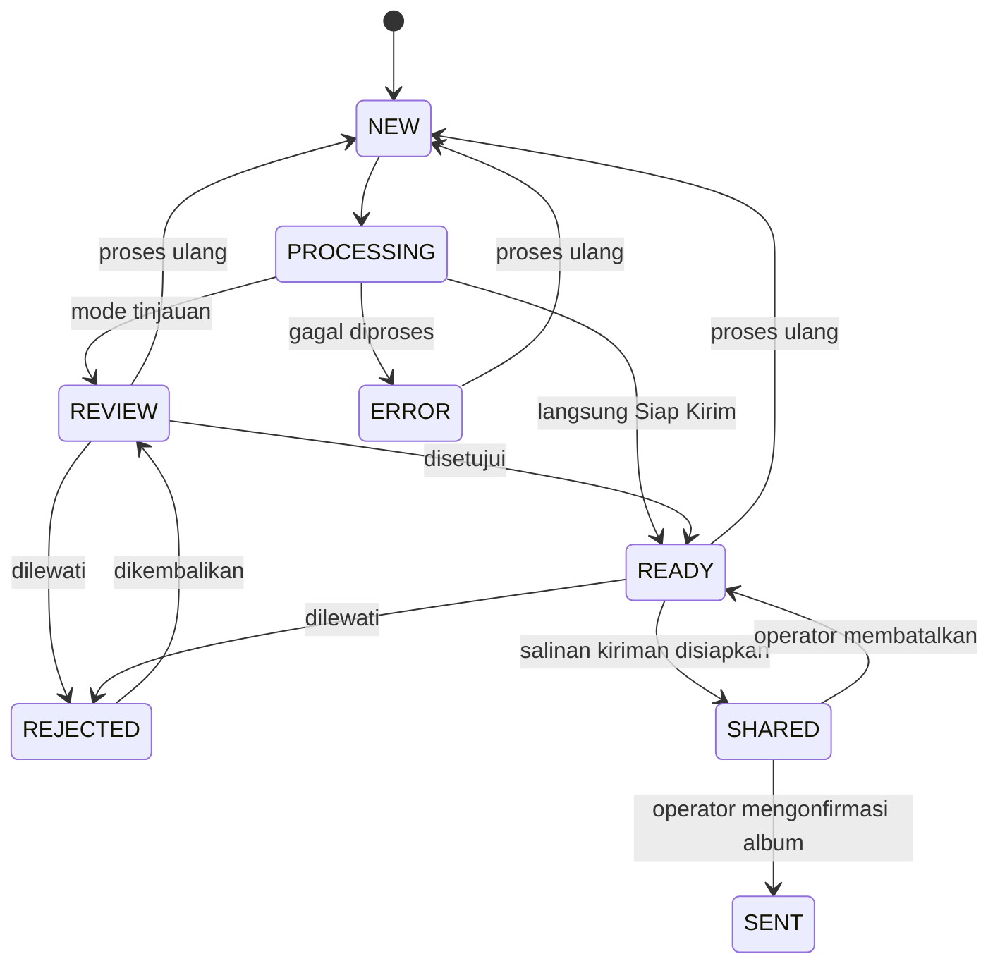

# Arsitektur Alpi 0.3

APK Android Java menangani deteksi kamera, pengolahan frame, tinjauan, antrean dan QR secara lokal. Aplikasi Google Photos menangani autentikasi akun, unggah, album dan akses tamu. Tidak ada komunikasi langsung APK Alpi ke layanan internet.

## Penyiapan acara

Operator membuat album di Google Photos dan menyalin tautan berbagi ke acara Alpi. Alpi tidak menafsirkan tautan sebagai ID album API. QR menyimpan tautan berbagi yang sama. Album dapat dibuka dari Alpi memakai ACTION_VIEW dengan Google Photos diprioritaskan dan browser sebagai cadangan.

## Deteksi dan pemrosesan

Mulai sesi mencatat baseline ID MediaStore, waktu mulai dan salinan konfigurasi frame/mode. ContentObserver serta pemeriksaan berkala memicu pipeline serial. Filter folder, ID dan waktu menolak foto lama, screenshot serta hasil ekspor sendiri. Salinan hasil mendapat frame/pita dan disimpan di penyimpanan privat; foto asli tetap utuh.

## Status foto

SENT berarti ditandai selesai oleh operator. Ini tidak menyatakan verifikasi server/Google Photos. Status DONE lama disimpan sebagai riwayat server 0.1.

## Penyerahan hasil

Satu kelompok maksimal 30 foto READY dari satu acara. Salinan JPEG tetap disimpan di direktori privat deliveries sebelum transaksi database memindahkan foto ke SHARED. ACTION_SEND atau ACTION_SEND_MULTIPLE menyertakan seluruh URI pada EXTRA_STREAM dan ClipData serta izin baca sementara. Hanya satu kelompok PENDING pada satu waktu; saat aplikasi dibuka ulang, operator dapat melanjutkan, memeriksa album, atau membatalkan.

Penerima tidak dijanjikan dapat memilih album. Operator menyelesaikan unggah dan penambahan album di Google Photos. Cadangan MediaStore menyalin hasil ke Pictures/Alpi/kode-acara tanpa mengubah foto asli; ekspor ulang memperbarui salinan galeri milik Alpi bila masih ada. Ekspor melalui Alpi juga menyiapkan kelompok kiriman PENDING. Ekspor tidak menandai selesai; konfirmasi operator tetap diperlukan setelah hasil terlihat di album.

## Migrasi

SQLite versi 2 menambah google_album_url, gallery_uri dan delivery_batches. URL server lama tetap di kolom album_url lama, tidak dijadikan QR Google Photos. Foto UPLOADING lama dikembalikan menjadi READY. Acara, frame, hasil dan DONE lama tidak dihapus. Migrasi berlaku untuk instalasi dengan tanda tangan APK yang kompatibel.

## Generator dan kompresi 0.3

SQLite versi 3 menambah JSON konfigurasi pemrosesan pada acara serta JSON statistik pada antrean. Frame PNG lama dan generator Basic/Pro merupakan pilihan mode. Pembacaan EXIF/MediaStore, rendering dan kompresi berjalan serial di HP. Generator memakai koordinat relatif dan merapikan irisan teks/logo. Studio menggunakan renderer yang sama untuk pratinjau.

Kompresi membatasi sisi panjang tanpa memperbesar foto kecil; kualitas JPEG dan dimensi tersimpan per acara. Proses ulang selalu membaca foto asli, menyalin konfigurasi terbaru dan menjaga kelompok kiriman aktif dari perubahan. Snapshot sesi lama tidak berubah setelah operator mengedit acara.
